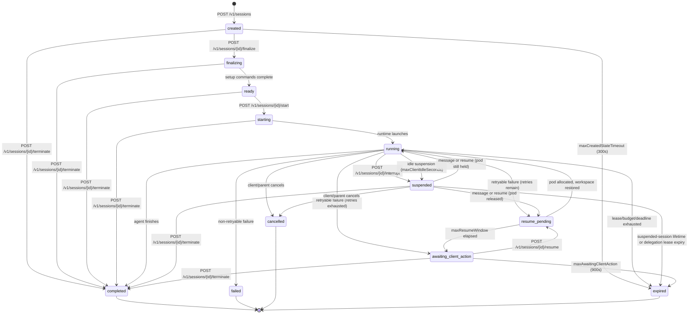
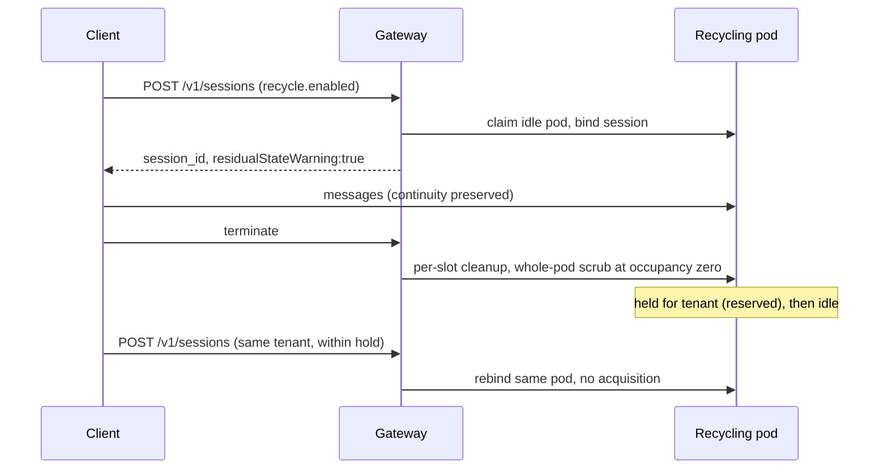
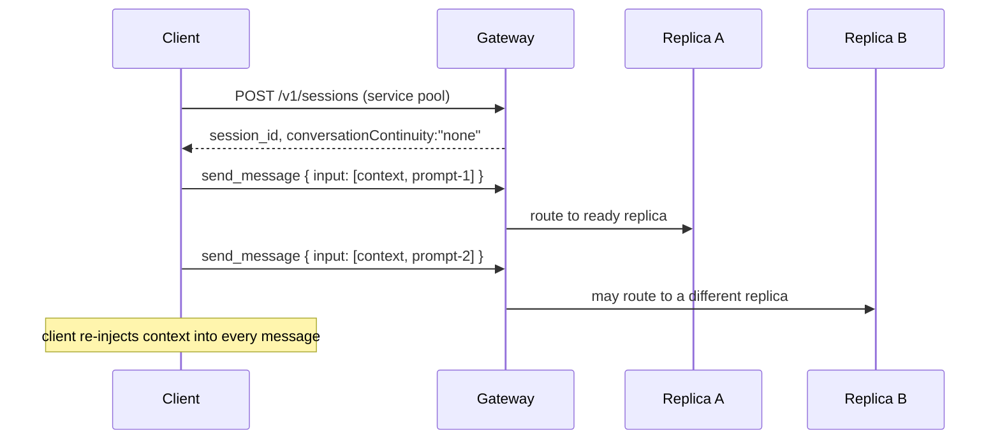

# Session Lifecycle

A Lenny session is a managed execution environment for an agent runtime. This page covers the complete session state machine, step-by-step API calls for each lifecycle phase, and all associated operations.

---

## Session State Machine



### State Descriptions

| State | Description | Terminal? |
|---|---|---|
| `created` | Session created; pod claimed and credentials assigned. Awaiting file uploads or finalization. TTL: `maxCreatedStateTimeoutSeconds` (default 300s). | No |
| `finalizing` | Workspace materialization and setup commands in progress. | No |
| `ready` | Setup complete, awaiting `start`. | No |
| `starting` | Agent runtime is launching. | No |
| `running` | Agent is actively executing. May also be in the `input_required` sub-state (see below). | No |
| `suspended` | Agent paused via `interrupt` or by idle suspension; workspace preserved. After an interrupt the pod is held for up to `maxSuspendedPodHoldSeconds` and then released; an idle suspension releases the pod as it suspends the session. Any message or resume call resumes the session. The session expires after `gateway.maxSuspendedSessionSeconds` (default 7 days) in this state. | No |
| `resume_pending` | Gateway is restoring the session onto a new pod, after a pod failure or a resume of a `suspended` session whose pod was released. | No |
| `awaiting_client_action` | Retries exhausted or resume window elapsed; client must explicitly resume or terminate. | No |
| `completed` | Agent finished successfully. | Yes |
| `failed` | Unrecoverable error. | Yes |
| `cancelled` | Cancelled by client or parent. | Yes |
| `expired` | Lease, budget, or deadline exhausted. | Yes |

### The `input_required` Sub-State

`input_required` is a **sub-state of `running`**, not a peer state. When an agent runtime calls `lenny/request_input`, the session enters `input_required`: the pod is live and the runtime is active, but the session is blocked waiting for client input. The `input_required` sub-state is surfaced to clients via `status_change` events. The session transitions back to `running` when input is provided.

While in `input_required`, the session is logically active and `maxSessionAge` keeps running. The `maxClientIdleSeconds` idle clock is not evaluated, because the runtime is waiting for the client, so the session is not idle-suspended; it keeps its pod until `maxSessionAge` expires it or the `lenny/request_input` call expires. From `input_required`, the session can also transition to `cancelled` (if the parent cancels), `expired` (if a deadline is reached), `resume_pending` (on a retryable failure with retries remaining), `awaiting_client_action` (on a retryable failure with retries exhausted), or `failed` (on a non-retryable failure). The session's `retryPolicy` classifies each pod or runtime failure as retryable or non-retryable.

---

## Step-by-Step Lifecycle

{: .note }
> **Happy path in one line:** `create` → (optionally upload files) → `finalize` → (reaches `ready`) → `start` → (reaches `running`) → send messages → `terminate` (or agent finishes). Every step below is an explicit API call; you cannot skip straight to `running`, and messages sent before `running` return `TARGET_NOT_READY`.

### a. Create Session

```
POST /v1/sessions
Content-Type: application/json
Authorization: Bearer <token>

{
  "runtime": "claude-worker",
  "pool": "default-pool",
  "labels": {
    "project": "my-app",
    "environment": "staging"
  },
  "retryPolicy": {
    "mode": "auto_then_client",
    "maxRetries": 2,
    "retryableFailures": ["pod_evicted", "node_lost", "runtime_crash"],
    "nonRetryableFailures": [
      "workspace_validation_failed",
      "setup_command_failed",
      "credential_rejected"
    ],
    "maxSessionAgeSeconds": 7200,
    "maxResumeWindowSeconds": 900
  },
  "metadata": {
    "description": "Code review session"
  }
}
```

**Response** (`201 Created`):

```json
{
  "sessionId": "sess_abc123",
  "uploadToken": "sess_abc123.1712345678.a1b2c3d4e5f6...",
  "sessionIsolationLevel": {
    "executionMode": "session",
    "isolationProfile": "gvisor",
    "podReuse": false,
    "residualStateWarning": false,
    "conversationContinuity": "platform"
  },
  "state": "created",
  "createdAt": "2026-01-15T10:30:00Z"
}
```

The `uploadToken` is a short-lived, session-scoped HMAC-SHA256 token. Treat it as a secret; do not log it or include it in URLs. It expires at `session_creation_time + maxCreatedStateTimeoutSeconds`.

### b. Upload Files

```
POST /v1/sessions/sess_abc123/upload
Content-Type: multipart/form-data
Authorization: Bearer <token>
X-Upload-Token: sess_abc123.1712345678.a1b2c3d4e5f6...

--boundary
Content-Disposition: form-data; name="files"; filename="main.py"
Content-Type: application/octet-stream

<file contents>
--boundary
Content-Disposition: form-data; name="files"; filename="config.yaml"
Content-Type: application/octet-stream

<file contents>
--boundary--
```

**Response** (`200 OK`):

```json
{
  "uploaded": [
    {"path": "main.py", "size": 1234},
    {"path": "config.yaml", "size": 567}
  ]
}
```

**Upload rules:**
- All paths are relative to the workspace root
- Paths with `..`, absolute paths, and symlinks are rejected
- Per-file and total session size limits are enforced
- Supported archive formats: `tar.gz`, `tar.bz2`, `zip` (extracted automatically)
- Zip bomb protection: decompression ratio limit (default 100:1)

### c. Finalize Workspace

```
POST /v1/sessions/sess_abc123/finalize
Authorization: Bearer <token>
X-Upload-Token: sess_abc123.1712345678.a1b2c3d4e5f6...
```

**Response** (`200 OK`):

```json
{
  "state": "ready",
  "setupOutput": {
    "commands": [
      {
        "command": "pip install -r requirements.txt",
        "exitCode": 0,
        "durationMs": 3200
      }
    ]
  }
}
```

Finalization validates the staging area, materializes the workspace, and runs any setup commands configured on the runtime. The upload token is consumed; it cannot be reused after this call.

### d. Start Session

```
POST /v1/sessions/sess_abc123/start
Authorization: Bearer <token>
```

**Response** (`200 OK`):

```json
{
  "state": "running",
  "startedAt": "2026-01-15T10:30:05Z"
}
```

The agent runtime launches and begins executing. You can now send messages and receive streaming output.

### e. Send Messages

```
POST /v1/sessions/sess_abc123/messages
Content-Type: application/json
Authorization: Bearer <token>

{
  "input": [
    {
      "type": "text",
      "inline": "Review the code in main.py and suggest improvements."
    }
  ]
}
```

**Response** (`200 OK`):

```json
{
  "messageId": "msg_xyz789",
  "deliveryReceipt": {
    "status": "delivered",
    "timestamp": "2026-01-15T10:30:06Z"
  }
}
```

**Delivery semantics** vary by session state:

| Session State | Behavior |
|---|---|
| `running` (runtime available) | Delivered to runtime stdin |
| `running` (tool call in flight) | Buffered in session inbox, delivered when runtime is ready |
| `suspended` | Resumes the session, whatever the `delivery` value. A message sent through `POST /v1/sessions/{id}/messages` and served by the session's coordinating gateway replica while the session holds its pod is delivered synchronously, with the receipt `delivered`. Every other admitted message, including an MCP `send_message` and a `lenny/send_message` from another session, is held in the session's dead-letter queue until the resume delivers it, with the receipt `queued`, or `dropped` with reason `dlq_overflow` when the enqueue evicts an entry from a full dead-letter queue. Refused with `QUOTA_EXCEEDED` when a concurrent-session limit the session counts toward is full. A message admitted on entry whose resume is then refused, because another admission took the last slot, is held in the dead-letter queue with the same receipts. The session stays `suspended`, and the gateway resumes it once a slot frees |
| `resume_pending` / `awaiting_client_action` | Enqueued in dead-letter queue with TTL |
| Pre-running (`created`, `ready`, `starting`) | Rejected with `TARGET_NOT_READY` for external clients |
| Terminal | Rejected with `TARGET_TERMINAL` |

### f. Interrupt (Suspend)

```
POST /v1/sessions/sess_abc123/interrupt
Authorization: Bearer <token>
```

**Response** (`200 OK`):

```json
{
  "state": "suspended",
  "suspendedAt": "2026-01-15T10:35:00Z"
}
```

Valid only when the session is `running`. What the agent receives depends on its runtime's [integration level](../runtime-author-guide/integration-levels.md). The pod is held for up to `maxSuspendedPodHoldSeconds` (default 900s). When the hold ends, the gateway checkpoints the workspace and releases the pod, and the session stays `suspended`. When that checkpoint fails, the gateway keeps the pod held and retries the checkpoint at its next evaluation, 60 seconds later, so the pod stays held until a checkpoint succeeds or the session leaves `suspended`. When the hold ends and the session's dead-letter queue holds a message the gateway accepted after the session entered `suspended`, the gateway resumes the session rather than releasing the pod. Inbox entries and messages held before the interrupt do not trigger this resume. When the concurrent-session admission check refuses that resume, the gateway still checkpoints the workspace and releases the pod, the session stays `suspended`, and the gateway resumes it at a later backlog re-check once the check admits it (see `gateway.suspendedBacklogRecheckSeconds` in the [configuration reference](../reference/configuration.md#core-gateway-settings)).

### Idle Suspension

A `running` session with no activity for `maxClientIdleSeconds` (default 900s) is suspended by the gateway, and its pod or slot is released. A message to the session, its runtime's output and tool use, and the runtime's `busy` report on its heartbeat acknowledgement all count as activity. The runtime adapter in the pod keeps its own activity window for the session, and a session whose adapter observed activity within the window stays `running`. The gateway checkpoints the workspace and releases the pod or slot in the same sequence that suspends the session, so an idle-suspended session never holds a pod.

A session that cannot be idle-suspended expires with the `max_idle_time` reason instead. These are sessions whose runtime is `type: mcp` and sessions whose pool runs `executionMode: service`.

A `suspended` session, whether interrupted or idle-suspended, does not count toward the concurrent-session limits, and the `maxSessionAge` and `maxClientIdleSeconds` clocks are paused while it is suspended. The session expires with the `max_idle_time` reason when it stays `suspended` for `gateway.maxSuspendedSessionSeconds` (default 604800s, 7 days).

### g. Resume

The gateway recovers a session automatically. After a retryable pod or stream failure, the session enters `resume_pending`, and the gateway's resume driver claims a replacement pod and restores the session onto it. The driver restores the workspace from the latest checkpoint. A session that has neither a checkpoint nor a minimal eviction state record is rebuilt from its workspace plan, including its setup commands, with no carried conversation state. The restore assigns the session new credential leases on the replacement pod, and while the pool or the credential pool is exhausted the session waits in `resume_pending`.

`retryCount` advances by one each time a pod failure, a failure of a restore after the session has entered the internal `resuming` state (the resume driver's `resume_pending` to `resuming` write), or the gateway's watchdog for a stalled restore moves the session into `resume_pending`. A successful restore does not advance it, and a resume requested by a client or by a message does not advance it. A retryable failure that occurs when `retryCount` has already reached `retryPolicy.maxRetries` moves the session to `awaiting_client_action` instead of `resume_pending`. The session also moves to `awaiting_client_action` when it stays in `resume_pending` for `maxResumeWindowSeconds`, when a restore fails with a non-retryable failure (for example a setup-command failure in a rebuild from the workspace plan, or a refused credential lease), or when it is the root session of a delegation tree whose budget state cannot be reconstructed after a Redis recovery.

`POST /v1/sessions/{id}/resume` is the client override. It resumes a session in `awaiting_client_action` or a `suspended` session:

```
POST /v1/sessions/sess_abc123/resume
Authorization: Bearer <token>
```

**Response** (`200 OK`):

```json
{
  "state": "resume_pending",
  "resumeRequestedAt": "2026-01-15T10:40:00Z"
}
```

The call returns the session in its new state. From `awaiting_client_action`, and from a `suspended` session whose pod was released, the session is returned in `resume_pending`: the resume driver restores it onto a new pod, and the restore's outcome arrives on the event stream as a `status_change` event. A `suspended` session whose pod is still held is returned in `running`. The MCP `resume_session` tool behaves the same way.

A message to a `suspended` session also resumes it, whatever its `delivery` value, so a client does not need to call `resume` before sending a message.

A `suspended` session does not count toward the concurrent-session limits, and resuming it counts it again. When a limit the session counts toward is full, the resume, or the message that would resume the session, is refused with `429 QUOTA_EXCEEDED`, and the session stays `suspended`. The gateway checks a message when it arrives and checks again before the state write that resumes the session. When the first check admits the message and the second refuses it, because another admission took the last slot, the message is held in the session's dead-letter queue rather than refused. It receives the receipt `queued`, or `dropped` with reason `dlq_overflow` when the enqueue evicts an entry from a full dead-letter queue. The session stays `suspended`, and the gateway resumes it and delivers the held message once the check admits the resume. A `queued` receipt for a `suspended` session therefore does not mean the session has resumed. A client that sent an `Idempotency-Key` with a refused resume retries with a new key, because the gateway returns the cached refusal for the original key until that key expires.

### h. Terminate

```
POST /v1/sessions/sess_abc123/terminate
Authorization: Bearer <token>
```

**Response** (`200 OK`):

```json
{
  "state": "completed",
  "terminatedAt": "2026-01-15T10:45:00Z"
}
```

Valid in any non-terminal state. Ending a session ends the session and sends the runtime process no signal: the workspace is sealed and exported, and artifacts are persisted.

### i. Delete (Force Terminate + Cleanup)

```
DELETE /v1/sessions/sess_abc123
Authorization: Bearer <token>
```

**Response** (`200 OK`):

```json
{
  "state": "cancelled"
}
```

Force-cancels the session and releases all resources. Unlike `/terminate` (which records a graceful, successful `completed` state), `DELETE` always records a `cancelled` terminal state for audit and billing. Use `/terminate` when the session's work is done; use `DELETE` to abandon a session.

---

## Convenience Endpoint: Create + Start in One Call

For simple workflows, skip the multi-step process:

```
POST /v1/sessions/start
Content-Type: application/json
Authorization: Bearer <token>

{
  "runtime": "claude-worker",
  "pool": "default-pool",
  "inlineFiles": [
    {
      "path": "main.py",
      "content": "print('hello world')"
    }
  ],
  "message": {
    "input": [
      {
        "type": "text",
        "inline": "Review this code."
      }
    ]
  },
  "callbackUrl": "https://my-app.example.com/webhooks/lenny"
}
```

**Response** (`201 Created`):

```json
{
  "sessionId": "sess_def456",
  "state": "running",
  "uploadToken": "sess_def456.1712345678.a1b2c3d4e5f6...",
  "sessionIsolationLevel": {
    "executionMode": "session",
    "isolationProfile": "gvisor",
    "podReuse": false,
    "residualStateWarning": false,
    "conversationContinuity": "platform"
  }
}
```

This creates the session, uploads inline files, finalizes, starts, and optionally sends the first message in one request. The optional `callbackUrl` enables webhook notifications (see [Webhooks](webhooks.html)).

---

## Execution Modes and Pod Isolation

The `sessionIsolationLevel` object in the create response describes how the assigned pool uses pods. A client that requires strict per-session isolation should inspect it before proceeding.

| Field | Description |
| :--- | :--- |
| `executionMode` | `session` (a managed session bound to a claimed pod) or `service` (each message routed to any ready replica) |
| `isolationProfile` | `runc`, `gvisor`, or `microvm` |
| `podReuse` | `true` when the pool recycles pods, runs `maxConcurrentSessions > 1`, or is service mode |
| `scrubPolicy` | Present only when `podReuse: true`; `best-effort`, `vm-restart`, `best-effort-in-place`, `best-effort-per-slot`, or `none` |
| `residualStateWarning` | `true` when the pod may carry residual state from prior sessions, sibling slots, or same-tenant concurrent requests. On a recycling pool a session may run in a runtime process that served an earlier session of the same tenant. |
| `conversationContinuity` | `platform` for session mode; `none` for service mode |

When `residualStateWarning: true`, the session runs on a pool configured to reuse pods (`recycle.enabled: true`, `maxConcurrentSessions > 1`, or service mode). On a recycling pool a session may run in a runtime process that served an earlier session of the same tenant. Reject the session if your use case cannot tolerate residual state (DNS cache, TCP `TIME_WAIT`, page cache, or shared process state).

### Session mode with recycling

In session mode the platform binds the session to a pod and preserves conversation context for the session's lifetime (`conversationContinuity: "platform"`). When the pool sets `recycle.enabled: true`, the pod is reused across sequential sessions of the same tenant; a whole-pod scrub runs when occupancy reaches zero, and the pod is held for the tenant for a short window before returning to the idle pool, unless the release ends the occupancy without reuse ([Recycle lifecycle](../reference/execution-modes#recycle-lifecycle)). Recycling is transparent to the client: the session API is unchanged, and the only client-visible signal is `podReuse: true` / `residualStateWarning: true` in the response.



### Service mode

In service mode the gateway routes each message to any ready tenant-pinned replica (`conversationContinuity: "none"`). The platform maintains no conversation context between messages, and successive messages of one session may land on different replicas. A session is a connection handle. Clients of a `multi_turn` runtime served in service mode must re-inject any needed context into each message's `input`:



---

## Session Derive (Fork)

Create a new session pre-populated with an existing session's workspace snapshot:

```
POST /v1/sessions/sess_abc123/derive
Content-Type: application/json
Authorization: Bearer <token>

{
  "runtime": "claude-worker-v2",
  "pool": "default-pool",
  "allowStale": false
}
```

**Response** (`201 Created`):

```json
{
  "sessionId": "sess_ghi789",
  "parentSessionId": "sess_abc123",
  "workspaceSnapshotSource": "sealed",
  "workspaceSnapshotTimestamp": "2026-01-15T10:45:00Z",
  "uploadToken": "sess_ghi789.1712345678.a1b2c3d4e5f6...",
  "state": "created"
}
```

**Source session state rules:**

| Source State | Allowed | `allowStale` Required | Snapshot Source |
|---|---|---|---|
| `completed` | Yes | No | Sealed final workspace |
| `failed` | Yes | No | Last successful checkpoint |
| `cancelled`, `expired` | Yes | No | Sealed or last checkpoint |
| `running`, `suspended`, `resume_pending`, `awaiting_client_action` | Yes | **Yes** | Last checkpoint (may lag by up to checkpoint interval) |

The derived session is independent: it goes through standard credential policy evaluation and receives its own credential lease. Connector OAuth tokens are not inherited.

---

## Session Replay (Regression Testing)

Re-run a session against a different runtime version:

```
POST /v1/sessions/sess_abc123/replay
Content-Type: application/json
Authorization: Bearer <token>

{
  "targetRuntime": "claude-worker-v2",
  "replayMode": "prompt_history",
  "evalRef": "eval-2026-q1"
}
```

**Response** (`201 Created`):

```json
{
  "sessionId": "sess_jkl012",
  "state": "created",
  "uploadToken": "sess_jkl012.1712345678.a1b2c3d4e5f6..."
}
```

The source session must be in a terminal state. Two replay modes:

- `prompt_history` (default): replays the source session's prompt history verbatim against the new runtime
- `workspace_derive`: starts fresh with an identical filesystem state but no pre-loaded prompts

---

## State Transition Preconditions

| Endpoint | Valid Precondition States | Resulting Transition |
|---|---|---|
| `POST /v1/sessions/{id}/upload` | `created`; also `running` if mid-session upload enabled | Remains in current state |
| `POST /v1/sessions/{id}/finalize` | `created` | `finalizing` then `ready` |
| `POST /v1/sessions/{id}/start` | `ready` | `starting` then `running` |
| `POST /v1/sessions/{id}/interrupt` | `running` | `suspended` |
| `POST /v1/sessions/{id}/terminate` | Any non-terminal | `completed` |
| `POST /v1/sessions/{id}/resume` | `awaiting_client_action`, `suspended` | `awaiting_client_action` to `resume_pending`; `suspended` to `resume_pending` when the pod was released; `suspended` to `running` when the pod is still held |
| `POST /v1/sessions/{id}/messages` | Any non-terminal | Varies by state (see delivery semantics) |
| `POST /v1/sessions/{id}/derive` | Terminal states; non-terminal with `allowStale: true` | Creates new session |
| `DELETE /v1/sessions/{id}` | Any non-terminal | `cancelled` |

Calling an endpoint in an invalid state returns `409 INVALID_STATE_TRANSITION` with `details.currentState` and `details.allowedStates`.

---

## Artifacts and Introspection

Once a session is running or completed, you can access its outputs:

### List Artifacts

```bash
curl -s https://lenny.example.com/v1/sessions/sess_abc123/artifacts \
  -H "Authorization: Bearer $TOKEN" | jq .
```

```json
{
  "items": [
    {"path": "output/result.json", "size": 4567, "mimeType": "application/json"},
    {"path": "output/report.md", "size": 12340, "mimeType": "text/markdown"}
  ],
  "cursor": null,
  "hasMore": false
}
```

### Download a Specific Artifact

```bash
curl -s https://lenny.example.com/v1/sessions/sess_abc123/artifacts/output/result.json \
  -H "Authorization: Bearer $TOKEN" -o result.json
```

### Download Workspace Snapshot

```bash
curl -s https://lenny.example.com/v1/sessions/sess_abc123/workspace \
  -H "Authorization: Bearer $TOKEN" -o workspace.tar.gz
```

### Get Session Transcript

```bash
curl -s "https://lenny.example.com/v1/sessions/sess_abc123/transcript?limit=50" \
  -H "Authorization: Bearer $TOKEN" | jq .
```

### Get Session Logs

```bash
# Paginated JSON
curl -s "https://lenny.example.com/v1/sessions/sess_abc123/logs?limit=100" \
  -H "Authorization: Bearer $TOKEN" | jq .

# Streaming via SSE (see Streaming page)
curl -N "https://lenny.example.com/v1/sessions/sess_abc123/logs" \
  -H "Authorization: Bearer $TOKEN" \
  -H "Accept: text/event-stream"
```

### Get Setup Command Output

```bash
curl -s https://lenny.example.com/v1/sessions/sess_abc123/setup-output \
  -H "Authorization: Bearer $TOKEN" | jq .
```

### Get Delegation Tree

```bash
curl -s https://lenny.example.com/v1/sessions/sess_abc123/tree \
  -H "Authorization: Bearer $TOKEN" | jq .
```

### Get Usage

```bash
curl -s https://lenny.example.com/v1/sessions/sess_abc123/usage \
  -H "Authorization: Bearer $TOKEN" | jq .
```

```json
{
  "inputTokens": 15000,
  "outputTokens": 8000,
  "wallClockSeconds": 120,
  "podMinutes": 2.1,
  "credentialLeaseMinutes": 1.8,
  "treeUsage": {
    "inputTokens": 45000,
    "outputTokens": 22000,
    "wallClockSeconds": 450,
    "podMinutes": 12.5,
    "totalTasks": 4
  }
}
```

The `treeUsage` field is populated only when the session has a delegation tree and all descendants have settled.

---

## TTLs and Timeouts

| Timeout | Default | Description |
|---|---|---|
| `maxCreatedStateTimeout` | 300s | Time allowed in `created` state before auto-expiry |
| `maxSessionAge` | 7200s (2h) | Maximum active session time. The clock pauses while the session is `suspended`, `resume_pending`, or `awaiting_client_action` |
| `maxClientIdleSeconds` | 900s (15m) | Time without activity before the session is idle-suspended, or expired when it cannot be idle-suspended |
| `maxResumeWindow` | 900s (15m) | Maximum time a session stays in `resume_pending` before it moves to `awaiting_client_action` |
| `maxAwaitingClientAction` | 900s (15m) | Time in `awaiting_client_action` before auto-expiry |
| `maxSuspendedPodHold` | 900s (15m) | Time an interrupted session holds its pod before the gateway checkpoints the workspace and releases it. A failed checkpoint keeps the pod held and is retried at the next evaluation, and a session whose dead-letter queue holds a message the gateway accepted after the session entered `suspended` is resumed rather than released. When the concurrent-session admission check refuses that resume, the gateway still checkpoints the workspace and releases the pod, and the session stays `suspended` until a later backlog re-check admits it. An idle suspension holds no pod |
| `gateway.maxSuspendedSessionSeconds` | 604800s (7d) | Suspended-session lifetime: time a session stays `suspended` before it expires |

A `session_expiring_soon` event is sent to the client and pod 5 minutes before `maxSessionAge` expires.

---

## Artifact Retention

Session artifacts (workspace snapshots, logs, transcripts) are retained for a configurable TTL (default: 7 days). Extend retention on specific sessions:

```
POST /v1/sessions/sess_abc123/extend-retention
Content-Type: application/json
Authorization: Bearer <token>

{
  "ttlSeconds": 2592000
}
```

**Response** (`200 OK`):

```json
{
  "retentionExpiresAt": "2026-02-14T10:30:00Z"
}
```

---

## Get Session Status

Poll the session state:

```bash
curl -s https://lenny.example.com/v1/sessions/sess_abc123 \
  -H "Authorization: Bearer $TOKEN" | jq .
```

```json
{
  "sessionId": "sess_abc123",
  "state": "running",
  "runtime": "claude-worker",
  "pool": "default-pool",
  "createdAt": "2026-01-15T10:30:00Z",
  "startedAt": "2026-01-15T10:30:05Z",
  "labels": {"project": "my-app"},
  "sessionIsolationLevel": {
    "executionMode": "session",
    "isolationProfile": "gvisor",
    "podReuse": false,
    "residualStateWarning": false,
    "conversationContinuity": "platform"
  },
  "retryPolicy": {
    "mode": "auto_then_client",
    "maxRetries": 2,
    "retryCount": 0
  }
}
```

### List Sessions

```bash
curl -s "https://lenny.example.com/v1/sessions?status=running&runtime=claude-worker&limit=20" \
  -H "Authorization: Bearer $TOKEN" | jq .
```

Supports filtering by `status`, `runtime`, `labels`, and pagination via `cursor` and `limit`.
