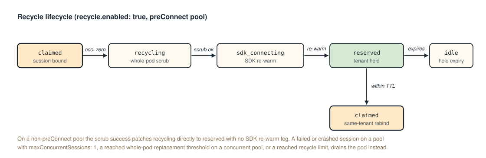

# Execution Modes and Pod Lifecycle

A runtime runs in one of two execution modes. `session` binds a managed session to a claimed pod and is parameterized by the `sessionPolicy` block. `service` routes each message to any ready replica with no claim and no conversation continuity. The pool scaling factors derive from the policy properties (see [Scaling](../operator-guide/scaling)).

---

## The sessionPolicy settings matrix

```yaml
executionMode: session            # session | service
sessionPolicy:                    # session mode only
  maxConcurrentSessions: 1        # > 1 requires acknowledgeProcessLevelIsolation
  recycle:
    enabled: false                # true requires acknowledgeBestEffortScrub
    maxSessionsPerPod: 50         # required when enabled; counts every session served
    maxPodUptimeSeconds: 86400    # optional
    maxScrubFailures: 3
    onScrubFailure: warn          # warn | fail
    scrubProfile: standard        # standard | vm-restart | in-place
    # runtimeProcess: keep        # keep | restart; required, with no default, when recycle.enabled is true, maxSessionsPerPod > 1, and scrubProfile is not vm-restart; rejected on every other pool
    acknowledgeMicrovmResidualState: false  # required when scrubProfile: in-place
    allowCrossTenantReuse: false  # microvm-gated; never permitted when maxConcurrentSessions > 1
  cleanupCommands: []
  cleanupTimeoutSeconds: 60
  maxSessionAgeSeconds: 7200      # active-time session age cap
  maxClientIdleSeconds: 900       # inactivity bound before idle suspension or expiry (default 900)
  slotRetries: 1
  onPoolExhausted: reject         # reject | queue
  maxQueueWaitSeconds: 30
```

`service` mode does not use `sessionPolicy`; it keeps a per-pod [slot](glossary#slot) bound through the pool-level `maxConcurrent` field and routes by readiness.

---

## Presets

| Preset | `maxConcurrentSessions` | `recycle.enabled` | Behavior |
|:--|:--|:--|:--|
| One session per pod | 1 | `false` | Each pod is exclusive to one session and terminates when the session ends (default). |
| Pod reuse | 1 | `true` | The pod is recycled across sequential sessions of the same tenant with a whole-pod scrub at the occupancy-zero boundary. A pool with `maxSessionsPerPod` above 1 and a `scrubProfile` other than `vm-restart` sets `recycle.runtimeProcess` ([Runtime process lifetime](#runtime-process-lifetime)). |
| Concurrent | N | `true` | The pod serves up to N simultaneous sessions and recycles when occupancy reaches zero, unless the last release ends the occupancy without reuse ([Recycle lifecycle](../reference/execution-modes#recycle-lifecycle)). |
| Bounded cohort | N | `false` | The pod serves N concurrent sessions, then terminates after the cohort drains. |

The acknowledgments, tenant pinning, `residualStateWarning`, and the scaling factors derive from `sessionPolicy` properties: `acknowledgeBestEffortScrub` is required when recycling is enabled, `acknowledgeProcessLevelIsolation` is required when concurrency exceeds one and on a recycling pool with `recycle.maxSessionsPerPod` above 1, a `recycle.scrubProfile` other than `vm-restart`, and `recycle.runtimeProcess: keep`, `acknowledgeMicrovmResidualState` is required for `scrubProfile: in-place`, and tenant pinning is required when `maxConcurrentSessions > 1` or `recycle.enabled: true`.

## Runtime process lifetime

Every agent pod has a runtime-process lifetime, `keep` or `restart`, which the platform fixes when it creates the pod from the pool's `recycle.runtimeProcess` and records in the immutable pod label `lenny.dev/runtime-process`. A pool without the field creates `keep` pods. An edit of the field applies to the pods created after it, and a pod keeps the lifetime it was created with.

- A **`keep` pod** keeps its runtime process across the recycle boundary.
- A **`restart` pod** ends its runtime process in each whole-pod scrub, and the next session runs in a newly launched process.

`recycle.runtimeProcess` is required, with no default, on a reusing recycling pool, which is a pool with `recycle.enabled: true`, `recycle.maxSessionsPerPod` above 1, and a `recycle.scrubProfile` other than `vm-restart`. Pool admission rejects the field on every other pool. Pool admission rejects `restart` on a pool whose runtime is not restartable: a restartable runtime carries `command`, runs in `session` mode, and does not declare `capabilities.preConnect: true`. Retirement at `recycle.maxSessionsPerPod` or `recycle.maxPodUptimeSeconds` is the same for both lifetimes.

**Runtime process kept across sessions.** On a `keep` pod the runtime process lives as long as the pod, unless `DemoteSDK` ends it on an SDK-warm pod, so a later session runs in the runtime process that served the pod's earlier sessions, and that process carries state the whole-pod scrub does not reach. On a `restart` pod each runtime process lives from its launch to the next whole-pod scrub, which ends it together with every process it started, so no runtime process serves two sessions of a sequential pool. A reusing recycling pool under `recycle.runtimeProcess: keep` requires `acknowledgeProcessLevelIsolation: true`, and pool admission refuses the pool without it. A sequential pool under `restart` does not require it, and `acknowledgeBestEffortScrub` covers the state that persists there. A concurrent pool requires it under both values, because its sessions share a process while they overlap. An admitted update that takes a pool outside the acknowledgment rule (`recycle.enabled: false`, `maxSessionsPerPod: 1`, `scrubProfile: vm-restart`, or a sequential pool's change from `keep` to `restart`) takes effect at the next session: the gateway places no later session on a `keep` pod that served an earlier session, and drains each such pod an acquisition reads. A `restart` pod stays admitted after an edit of the field to `keep`.

---

## Residual state and isolation

The `sessionIsolationLevel` object in the `POST /v1/sessions` response reports the assigned pool's posture. `podReuse` and `residualStateWarning` are `true` when `recycle.enabled` is `true`, when `maxConcurrentSessions > 1`, or when `executionMode` is `service`.

| Configuration | Scrub at session release | `conversationContinuity` | Residual state across sessions |
|:--|:--|:--|:--|
| One session per pod | Per-slot cleanup at the session's release, then the pod is terminated | `platform` | None; the pod is never reused |
| Pod reuse | Per-slot cleanup at each release plus a best-effort whole-pod scrub at occupancy zero | `platform` | DNS cache, TCP `TIME_WAIT`, page cache, residual processes may survive a best-effort scrub; on a `keep` pod the runtime process and its memory persist (requires `acknowledgeProcessLevelIsolation`); on a `restart` pod the scrub ends the runtime process and removes the agent UID's IPC objects and files |
| Concurrent (`maxConcurrentSessions > 1`) | Per-slot cleanup at each release plus a whole-pod scrub at occupancy zero | `platform` | Concurrent slots share process namespace, `/tmp`, cgroup memory, and network stack |
| Service | None | `none` | Pods serve successive requests with no scrub; process space, network stack, `/tmp`, and page cache shared across same-tenant concurrent requests |

The per-slot cleanup runs at each session release in session mode, on a pod of any concurrency and any recycle setting. The whole-pod scrub runs at occupancy zero on a recycling pod, unless the release ends the occupancy without reuse ([Recycle lifecycle](#recycle-lifecycle)). What is distinctive to the `Concurrent` row is the co-tenancy its `Residual state across sessions` column names.

A client that requires strict isolation should reject a session whose response carries `residualStateWarning: true`.

---

## Recycle lifecycle

When occupancy reaches zero on a recycling pod, the gateway patches the pod's `SandboxClaim` to `recycling`, the adapter runs the whole-pod scrub, and the recycle disposition decides whether to hold the pod or retire it, unless the release ends the occupancy without reuse. A release ends the occupancy without reuse when the pool does not recycle, when the gateway releases the session before it published the session's binding to the pod, which is the case for a session that never started on the pod, or, on a pool with `maxConcurrentSessions: 1`, when the session failed or crashed. The gateway publishes a session's binding after the pod accepts the session's start or resume, and from then on it delivers the session's messages and its release to that pod. A release that ends the occupancy without reuse deletes the claim instead of patching it, and no whole-pod scrub runs. On a preConnect pool the SDK re-warm runs after a successful scrub before the claim enters `reserved`.



<!--
ASCII fallback for the diagram above (recycle-lifecycle):

  claimed ===(occ. zero)==> recycling ===(scrub ok)==> sdk_connecting ===(re-warm)==> reserved ===(expires)==> idle
                                                                                          |
                                                                                  (within TTL)
                                                                                          v
                                                                                       claimed (same-tenant rebind)

  On a non-preConnect pool the scrub success patches recycling directly to reserved with no SDK re-warm leg.
-->

The reserved hold extends the occupancy episode across an idle gap: a same-tenant session arriving within the deployment-level hold TTL (`gateway.claimHoldTTLSeconds`, default 10s) rebinds the pod with no acquisition round trip. When the pool's current configuration no longer admits the pod for reuse ([Runtime process lifetime](#runtime-process-lifetime)), the next acquisition ends the hold instead of rebinding it. A pod retires when it reaches `recycle.maxSessionsPerPod`, `recycle.maxScrubFailures`, or `recycle.maxPodUptimeSeconds`, when a session ends in failure or a crash on a pool with `maxConcurrentSessions: 1`, when its failed and leaked slots reach the whole-pod replacement threshold on a pool with `maxConcurrentSessions > 1`, when its host node is unschedulable, or when the adapter reports that its runtime cannot serve the next session (retirement reason `runtime_not_live`). See the full machine in [State Machines](state-machines).

---

## Decision guide

- **Default to one session per pod.** Use it when each session must run in a clean, single-use pod. It carries no residual-state risk.
- **Choose pod reuse (`recycle.enabled: true`) for sequential throughput** when cold-start cost dominates and the workload tolerates a best-effort scrub between sessions. Set `recycle.maxSessionsPerPod` to bound reuse. With `maxSessionsPerPod` above 1 and a `scrubProfile` other than `vm-restart`, choose `recycle.runtimeProcess`. Choose `restart` when a later session must not run in the process that served an earlier one; it needs a restartable runtime and costs a runtime launch at each reused session's start. Choose `keep` when the runtime's startup cost dominates and the workload tolerates a process shared across the tenant's sessions, and set `acknowledgeProcessLevelIsolation: true`. Under either value the runtime must serve sequential sessions.
- **Choose concurrent sessions (`maxConcurrentSessions > 1`) for lightweight handlers** that share a pod's process space, accepting process-level isolation between same-tenant slots.
- **Choose service mode for stateless, high-throughput request handling** where each message is self-contained. A `multi_turn` runtime in service mode requires the client to re-inject context into each message.
- **Prefer the external connector model** over service mode when the workload is a long-lived MCP server that external clients connect to directly. Connectors carry gateway-managed OAuth and content-policy interception, which service mode does not.

`recycle.allowCrossTenantReuse: true` applies only to the sequential-reuse path (`maxConcurrentSessions: 1`, `recycle.enabled: true`) with `isolationProfile: microvm`, and never on a `workspaceTier: T4` pool. A pod on such a pool is never reused across tenants, because a recycled pod keeps state the scrub does not reach and the tenant pin applies on every pool.
